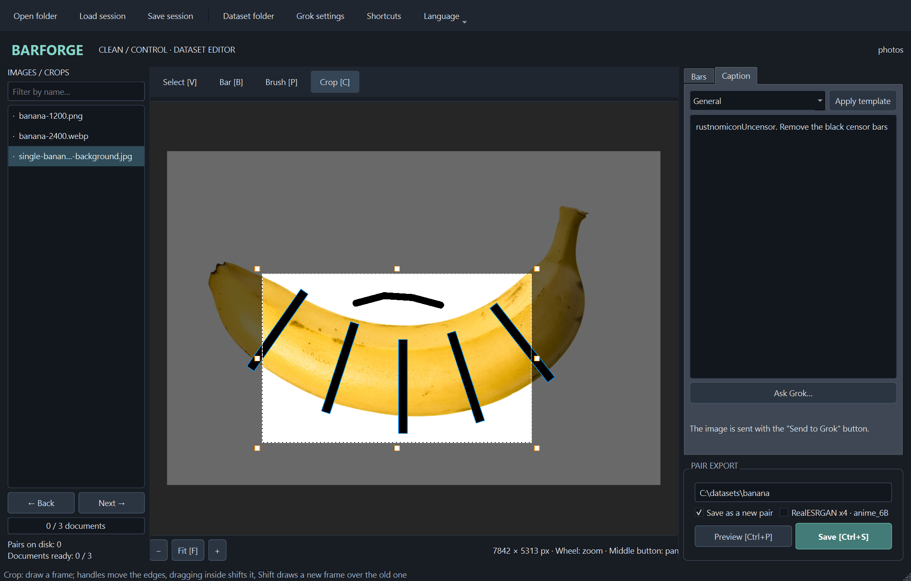
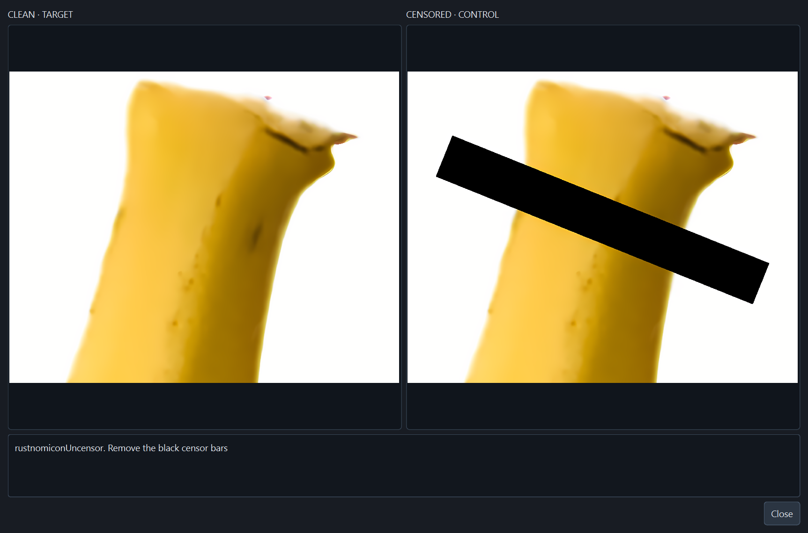
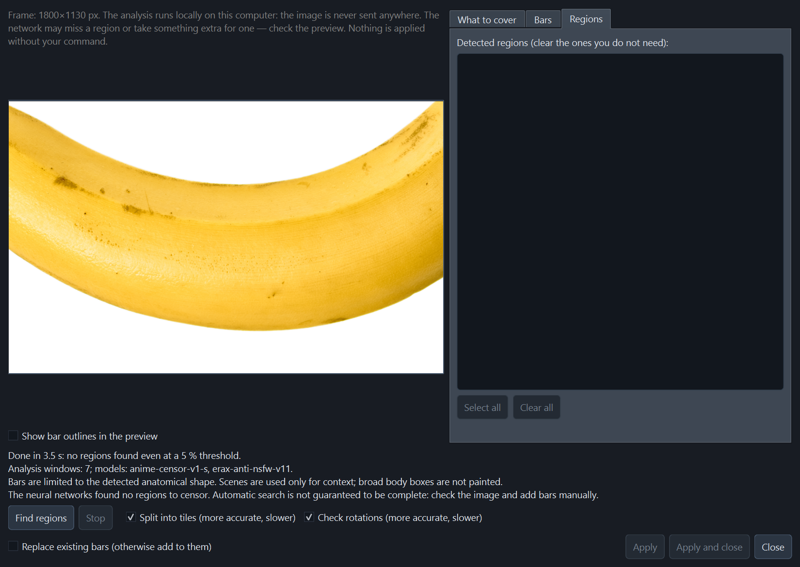
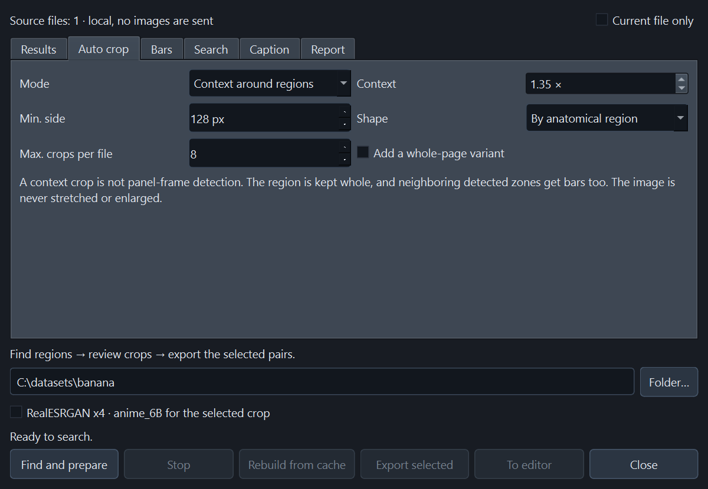
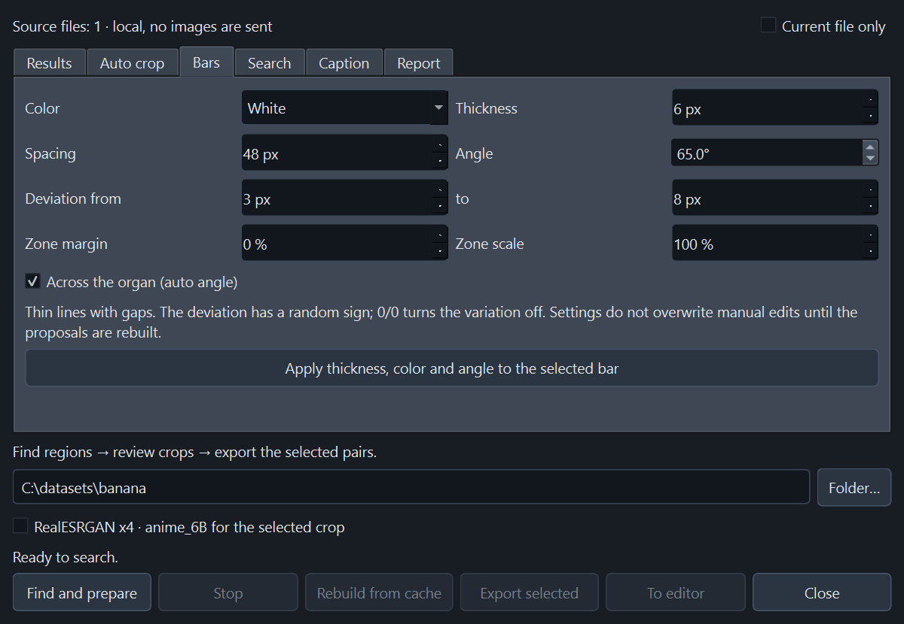
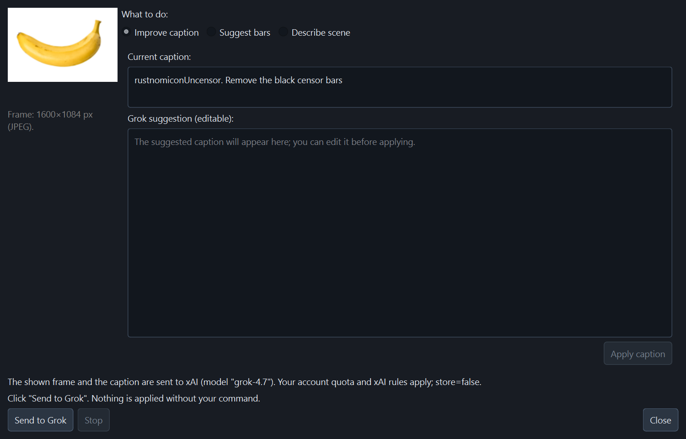
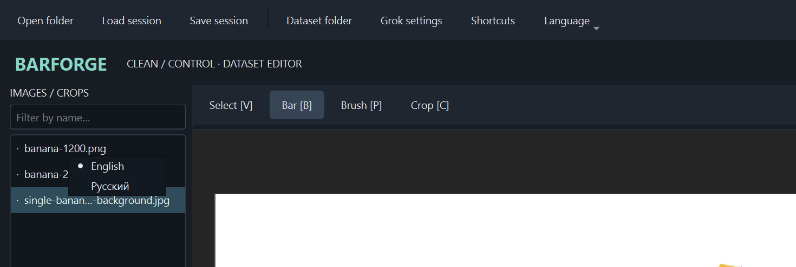
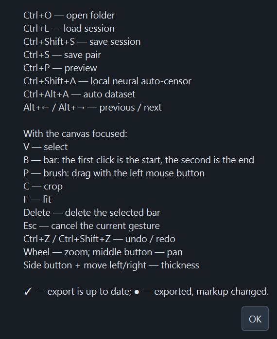

# BarForge

<p align="center">
  
</p>

BarForge is a local desktop application (Python + PySide6) for preparing **paired image-editing datasets**: a **clean** target image and a **censored** control image that differ only by bars drawn on top. Source images are never modified. The program paints new bars over the clean image; it does not reconstruct content hidden by a source that is already censored.

Everything runs on your machine. The optional Grok assistant is the only feature that can send an image over the network, and only when you press its send button.

## Screenshots

All screenshots show the application working on one sample photo, `single-banana-isolated-white-background.jpg` (7842 × 5313 px), so every feature below can be compared on the same input.

### Markup editor

Source list (JPG, WEBP and PNG side by side), a canvas with straight rotated bars and a freehand brush stroke, and the thickness, angle, color and preset controls. The export block at the bottom holds the dataset folder, **Save as a new pair**, the x4 switch, **Preview** and **Save**.


### Non-destructive crop and captions

The **Crop** tool selects a panel without touching the source; both exported images get the same rectangle. The **Caption** tab holds the text that is saved to `clean/*.txt`, ready-made templates, and **Ask Grok…**.



### Pair preview

**clean / target** and **censored / control** side by side, exactly as they will be exported, together with the caption.


### RealESRGAN x4 upscale

With **RealESRGAN x4 · anime_6B** enabled, both sides of the crop are upscaled by the same local model, so they stay aligned. Below, an 800 × 640 px crop of the stem became 3200 × 2560 px in both images.



### Local neural auto-censor

Thresholds, categories and search options. The analysis runs on your machine and nothing is applied until you press **Apply**.


When the networks find nothing, the dialog says so instead of inventing a region. This is the result on the banana photo, which is not something the models flag:



### Auto dataset

A whole folder becomes reviewable crops and bars, which you then check, preview and export as pairs. **Auto crop** sets the context, minimum side, shape and the number of crops per file; **Bars** sets color, thickness, spacing, angle and the random thickness deviation. The other tabs are **Results**, **Search**, **Caption** and **Report**.





### Grok assistant (optional)

xAI OAuth sign-in, model selection and token storage options:


**Ask Grok…** improves the caption, suggests bars or describes the scene. Nothing is sent until you press **Send to Grok**, and every answer is reviewed before it reaches the editor:



### Language and shortcuts

The **Language** menu switches between English and Russian; the choice applies after a restart. **Shortcuts** lists every key binding.





## Features

- Non-destructive crop, straight or rotated bars, and a freehand brush; every edit has Undo/Redo.
- Per-image captions with ready-made templates; the bar color is substituted as `white` / `black`.
- Exact pair export: `clean/NNN.png`, `clean/NNN.txt`, `censored/NNN.png`, identical size and alignment.
- Optional local **RealESRGAN x4 · anime_6B** upscale of both sides, with a persistent result cache.
- Local neural auto-censor (two ONNX models, no PyTorch, no GPU) that proposes thin, gapped bars for review.
- **Auto dataset**: process a whole folder into reviewable crops and bars, then export the selected pairs.
- Versioned session files (`*.barforge.json`) that hold markup only, never pixels or secrets.
- User interface in **English** (default) and **Russian**.

## Installation

Python **3.10+** on Windows, Linux or macOS. No GPU is needed.

```powershell
# Windows PowerShell, from the project folder
python -m venv .venv
.\.venv\Scripts\python.exe -m pip install -e .
.\.venv\Scripts\python.exe -m barforge
```

```bash
# Linux / macOS
python3 -m venv .venv
.venv/bin/python -m pip install -e .
.venv/bin/python -m barforge
```

Alternatively run `python -m pip install -r requirements.txt` and then `python main.py`. After installation the `barforge` command is available. On Linux the Qt/XCB and OpenGL system libraries are required and a graphical session is needed; for automated checks without a display set `QT_QPA_PLATFORM=offscreen`.

Prebuilt wheels and source distributions are attached to each [GitHub release](https://github.com/spgsroot/BarForge/releases).

## Language

English is the default. To switch, open **Language** in the toolbar and choose **English** or **Русский**. The choice is stored in the application settings and applied the next time BarForge starts, so a window never mixes two languages.

Translations live in `barforge/locales/en.json`. The Russian source strings in the code are the keys, and `tests/test_i18n.py` fails if any user-visible string lacks an English entry or if a placeholder does not match.

## Workflow

1. **Open folder** with PNG / JPG / JPEG / WEBP files. The list is sorted naturally (`2` before `10`); subfolders are not scanned. The name filter on the left hides entries without removing them from the session.
2. Choose **Dataset folder…**: the dataset root, not `clean` or `censored`.
3. Optionally select a panel with the **Crop** tool. The crop is non-destructive: both exported images receive the same rectangle. Handles move the edges, dragging inside shifts the crop, and `Shift` + drag draws a new frame inside the old one. **Reset crop** restores the full source.
4. **Bar**: click the start, then click the end as a separate second click; any direction works. **Brush** (`P`): drag with the left mouse button to draw a freehand stroke with round ends; it is only a preview until you release the button. Color and exact thickness are shared by bars and the brush. Hold the mouse side button and move right/left to increase/decrease the thickness (8 screen px per 1 source px). In **Select** a bar is moved or resized with its handles. One stroke is one Undo step; **Clear markup** removes all bars and strokes in one undoable action.
5. **Neural auto-censor…** (`Ctrl+Shift+A`) searches for sensitive regions locally: review the proposals in a separate dialog and apply the ones you keep. **+ Center** is a separate geometric preset without a network: it simply adds the chosen number of bars at the center of the image or crop.
6. On the **Caption** tab enter text or apply a template. Color: **White** → `white`, **Black** → `black`. Every page keeps its own text while you navigate; a page that has not been edited inherits the last used caption, and filled pages are never overwritten. Loading a session restores the text literally and does not substitute the current color into it.
7. Optionally enable **RealESRGAN x4 · anime_6B** for the current document. **Preview** shows the real export result, including x4; the heavy computation runs in the background and can be stopped.
8. **Save** writes two PNG files and a UTF-8 `.txt`. Saving the same document again asks to confirm the overwrite. **Save as a new pair** takes the next number and keeps the previous pair, which is handy for several crops of one source.
9. **Save session** stores bars, strokes, crops, captions, x4 flags, the current position, the dataset path and the links to exports. Before closing or switching projects the program offers to save changes. There is no autosave.

### Caption templates

The **Caption** tab offers a drop-down of ready-made caption templates. A template has the form `rustnomiconUncensor. Remove the {color} censor bars`, optionally followed by a short qualifier; `{color}` is replaced by the chosen bar color (`white` or `black`). Besides the **General** and **No color** variants there are four qualified variants. The exact texts are defined in `CAPTION_TEMPLATES` in `barforge/models.py`.

Changing the color keeps the type of a ready-made caption instead of resetting it to the general one. A `{color}` typed by hand is also substituted into the saved text, while the editor itself is not rewritten. Other curly braces are not interpreted, and custom text without `{color}` is never changed automatically.

### Window size and navigation

The main window and dialogs adapt to the available screen area, including the window frame. Controls are grouped into tabs: **Bars / Caption** in the main window, **What to cover / Bars / Regions** in the auto-censor, **Sign-in / About the client** in the Grok settings.

Scrolling stays with the image canvases. Long lists of sources and regions, captions and Grok answers use **← / →** buttons with a page number, so content is never clipped and is reachable without scroll bars.

### Dataset layout

```text
dataset/
├── clean/
│   ├── 001.png
│   ├── 001.txt
│   ├── 002.png
│   └── 002.txt
└── censored/
    ├── 001.png
    └── 002.png
```

Names are sequential (`001`, `002`, …, `1000`, …); an export never takes an existing number. The two PNG files have the same size: without x4 the crop resolution is preserved, with x4 each side is exactly quadrupled. EXIF orientation is applied before drawing; transparent images are composited on white and exported as RGB. Bars and strokes are clipped to the image or crop bounds.

The counter shows the number of complete pairs on disk. Progress counts sources whose last export matches the current markup: `✓` is up to date, `●` means the markup changed after export. Switching the dataset folder resets links to old exports but deletes no files. Earlier exported crops stay on disk; the session stores only the current markup of each source, not the history of every panel.

### AI-Toolkit / FLUX.2 Klein

Use `clean` as the target images and `censored` as conditioning/reference. Captions sit next to the targets. A dataset section for a compatible AI-Toolkit version:

```yaml
datasets:
  - folder_path: "C:/datasets/my_dataset/clean"
    control_path: "C:/datasets/my_dataset/censored"
    caption_ext: "txt"
    resolution: [512, 768, 1024]
```

This is **not a complete training config**: choose the model, architecture, buckets and LoRA parameters in your AI-Toolkit version. BarForge does not start training and does not need AI-Toolkit installed. Files are matched by identical file name. See the [BFL guide to edit-LoRAs for Klein](https://huggingface.co/blog/black-forest-labs/flux-2-klein-lora#train-an-edit-lora).

## RealESRGAN x4 for crops

`barforge/assets/RealESRGAN_x4plus_anime_6B.onnx` is the official [xinntao/Real-ESRGAN](https://github.com/xinntao/Real-ESRGAN) model tuned for anime/manga: **6 RRDB blocks**, scale **×4**, `params_ema` from release `v0.2.2.4`, converted to ONNX. **PyTorch and downloads at startup are not needed.** It runs locally through ONNX Runtime on the CPU; no network and no Grok are involved.

1. Select a crop and enable **RealESRGAN x4 · anime_6B** under the preview. The flag is stored per document and is part of the export signature.
2. Open the preview or save the pair. Clean and censored are processed independently by the same model, so their sizes and coordinates stay aligned. The batch dialog has the same flag for the selected crop.
3. Wait for the result. Progress counts tiles; **Stop upscale** cancels between tiles. An unfinished pair is never published; batch pairs that are already finished and their checkpoint are kept.

Processing uses **128 px** tiles with **48 px** overlap to bound memory and reduce seams. The right and bottom edges are padded by reflection by 10 px, as in the official inference. The limit is **16 777 216 output pixels** per side of a pair (for example 4096×4096); a larger crop must be made smaller. The long CPU computation runs in the background, and its speed depends on the processor.

**Upscale cache.** The successful result of each side (`clean` and `censored`) is stored separately. The key is the SHA-256 of the exact RGB pixels, the size, the SHA-256 of the ONNX model and the tiling parameters. A repeated preview, save, save as new pair or batch export of the same region therefore does not run the network; changing only the caption, the pair name or the dataset folder also hits the cache. Any change to the crop, bars, strokes, color or source pixels produces a new key: `clean` can stay a hit while the changed `censored` side is recomputed.

The cache persists between runs: on Windows `%LOCALAPPDATA%\BarForge\cache\realesrgan`, on Linux/macOS `$XDG_CACHE_HOME/barforge/realesrgan` or `~/.cache/barforge/realesrgan`; set `BARFORGE_CACHE_DIR` to change it. The 4 latest results are kept in memory and up to **2 GiB** of PNG files on disk, with the least recently used removed first. Writes are atomic; a corrupted or wrong-size file is deleted and recomputed. A cancelled computation or a model error never enters the cache, and a cache write failure does not cancel a finished pair. You can delete the cache at any time; the dataset is unaffected.

**This is generative restoration, not a lossless resize:** the model may rebuild halftone dots and fine strokes and create a different texture and artifacts. Check the preview before training; the source is never overwritten. Grok keeps receiving the original crop without x4 so its coordinates do not shift.

The origin, SHA-256 of the original weights and the ONNX file, the architecture and the numeric comparison are recorded in `barforge/assets/MODELS.json`. The BSD-3-Clause license is kept in `barforge/assets/REALESRGAN-LICENSE.txt`.

## Sessions and large folders

A session is a versioned JSON file (`*.barforge.json`) with no images and no secrets. The current format is **v2** with strokes and x4; **v1 is still read**, and the old export signatures of documents without the new features are preserved. Paths are stored relative to the session file when possible. Unavailable files are not removed from the session: restore them at the saved paths.

Memory holds the current image and its display; the other documents carry metadata only. Undo/Redo belong to the geometry of the current canvas and are reset when you move to another source; the caption uses the standard undo of the text editor. The session stores no Undo history. Very large sources still need memory proportional to the image size; if coordinate accuracy matters, do not downscale them outside the application before drawing bars.

## Local neural auto-censor

It needs no Grok, no API key, no GPU and sends no image anywhere. Two ONNX models of about 126 MB in total ship in `barforge/assets/`. A specialized model for drawn images produces the region predictions; the broad boxes of the second model are **never used for painting**. Its scene predictions serve only as context for refinement, and one additional region class is enabled by a separate option. GrabCut separates the foreground inside a region prediction; bars are confined to its outline, concavities and large background holes. The models run through ONNX Runtime on the CPU and are reused between analyses.

1. Open an image, select a crop if needed and click **Neural auto-censor…**.
2. Choose white or black, the **base thickness** in pixels and the spacing. **Across the organ (auto angle)** is on by default: every detected region gets its own angle. **Random thickness ±** in the main window and **Deviation from / to** in the dialogs set the range of automatic lines: **3–8 px** by default with a random sign. Whole numbers **0–64 px** are allowed; **0 / 0** turns the variation off and **4 / 4** gives **±4 px**. If the bounds cross, the other field follows. The manual brush and manual bars use the exact thickness without randomization, and the geometric **+ Center** is not randomized either. Margin and scale change the placement zone; the anatomy and scene-hint thresholds are set separately.
3. For small regions enable tile analysis, and for different orientations enable rotation checks. Both are slower, but on a test manga page rotations clearly improved the search.
4. Run the analysis. The GUI stays responsive and the work can be stopped. Only the current crop is analyzed, and coordinates are returned in the source coordinate system.
5. Clear the false or unneeded proposals. Color, base thickness, deviation range, spacing and angle change on the regions already found, without running the networks again. Then add the lines to the current ones or replace the existing ones. Insertion is one Undo step.

The mode produces **thin lines with open gaps**, not a filled detection rectangle. Defaults: thickness **6 px**, deviations **3–8 px** with a random sign, spacing **48 px**, **auto angle across every region**, margin **0%**. The manual base angle **65°** is used only when auto angle is off. The minimum effective thickness is **1 px**; small spacing or a small region limits the variation so the gaps stay. The whole rectangular bar must fit inside the detected shape, not only its center line.

Repeated predictions of one foreground are merged before the angle is chosen, so no overlapping grids appear. The thickness pattern is stable when you change the color or the region checkmarks; changing the range scales it instead of reshuffling. The length and number of lines depend on the region shape. After applying you can move the lines, resize them with the handles and change the angle with **Angle of the selected bar**. The actual thickness and angle of each bar are stored in the session and the export.

**Limitation:** the detector does not guarantee completeness or semantic accuracy, especially in manga. GrabCut refines the shape but does not recognize anatomy itself. A low threshold raises sensitivity and the number of false positives. If no shape is found the region is skipped; it is never replaced by a wide scene box. Scenes never become censor masks, even when the option is on. Before publishing, check false regions, misses and the correctness of the detected foreground by hand.

Models and origin: [deepghs/anime_censor_detection](https://huggingface.co/deepghs/anime_censor_detection) and [EraX-Anti-NSFW-V1.1](https://huggingface.co/erax-ai/EraX-Anti-NSFW-V1.1). Revisions, checksums, ONNX export parameters and the declared licenses are in `barforge/assets/MODELS.json`. The EraX card states Apache-2.0, while the Ultralytics exporter wrote AGPL-3.0 metadata into the ONNX file; check the terms of both before redistributing the weights. PyTorch and Ultralytics are not needed to run the application.

### Auto dataset: folder → crops → review → pairs

1. Open a source folder and click **Auto dataset…** (`Ctrl+Alt+A`). You can process the whole folder or only the current image. Everything is local.
2. On the **Auto crop** tab set the context, minimum side and shape. By default a crop follows the proportions of the anatomical region with **1.35×** context and a **128 px** minimum side, not panel frames or action boxes. Square and fixed proportions are separate options; the source is never stretched or enlarged. The number of crops is limited, and the whole page is added only explicitly.
3. On **Bars**, **Search** and **Caption** configure the style, categories, thresholds and template, then click **Find and prepare**. Every finished source stays available for review even if processing of the folder is stopped.
4. On **Results** review crops and bars and clear false proposals. The canvas supports two-click bars, the brush, crop and Undo/Redo; the caption is edited separately for each candidate. The x4 flag is set for the selected crop. **Pair preview** shows clean/control and the caption, including the real x4 result.
5. **Rebuild from cache** recomputes crops and bars without running the networks. It replaces manual edits after confirmation. Changing files, tiles, rotations or scene hints needs a new search; anatomy thresholds, categories and style apply to regions already found.
6. Choose the dataset folder and click **Export selected**. The aligned `clean/*.png`, `clean/*.txt`, `censored/*.png` and a separate `batch-*.barforge.json` are written. The session is updated after every published pair. On cancel or error finished pairs are kept; restore them by loading the session normally.
7. Unchanged exported candidates are not published again, including after a rebuild from cache. A changed variant gets a new number and the previous pair stays. **To editor** adds the selected documents to the main session without an implicit export.

These are proposals for review, not guaranteed finished markup. Neighboring organs that fall into a crop receive the same bars as on the full page. Auto crop is not panel detection, and it creates no pair for a scene where no anatomy was found.

## Grok (optional, agentic OAuth)

Without a completed OAuth sign-in **Ask Grok** is unavailable; loading, markup, preview and export all work locally with no network requests. No API key is needed or used: key entry and reading `XAI_API_KEY` were removed.

1. Open **Grok settings…**, enable the assistant and pick a model your account can use with image support. The model name is editable because model availability changes.
2. Choose the **OS secure storage** to keep the sign-in between launches, or **Until the program closes**. If secure storage is unavailable the sign-in is possible only until the program closes; plaintext files are never used.
3. Click **Sign in with xAI OAuth**. The official xAI page opens in the browser. Compare the displayed device code, sign in and approve access. Use the dialog buttons to copy the code or reopen the page.
4. Wait for the sign-in confirmation in the application and click **Save**. Waiting happens in the background and an unfinished sign-in can be canceled. Closing the settings cancels a pending sign-in, and a late answer does not save a session.
5. Click **Ask Grok…**. Choose caption generation/improvement, bar suggestions or a short neutral description of the scene and anatomy, then **Send to Grok**. There is no extra consent checkbox. Signing in and opening the image dialog send nothing; an answer is applied with a separate button after you review it.

**Client identity:** the public **Grok CLI** OAuth client used by agentic harnesses, not a BarForge registration of its own. Authorization is a real device-code flow through `auth.x.ai`; the browser page is `accounts.x.ai`. The application does not read cookies and does not ask for the xAI password. You must approve the sign-in explicitly on the provider page.

**xAI decides access:** a successful authorization does not guarantee that the selected subscription/account can use the inference API or every model. On `403` the application shows the refusal; it does not bypass limits and does not substitute an API key. Requests consume the quota available to your account; OAuth does not mean free or unlimited access.

Secrets are stored only in the permitted secure OS keyring backends or in process memory. The JSON settings keep only the integration switch and the model; a dataset session never contains tokens. When a refresh token exists, that one is stored in the keyring and the short-lived access token is renewed when needed. Refreshing is serialized and keeps refresh-token rotation. The session-only mode deletes an earlier persistent OAuth entry so it cannot come back after a restart.

**Sign out** forgets the local OAuth session and asks xAI to revoke access. If the provider is unavailable or the keyring refuses deletion, the application says so; after a failed remote revocation you can revoke access in your xAI account. Turning the assistant off is not a sign-out.

The clean current image **or the current crop** is sent, never the whole set. The request uses HTTPS `https://api.x.ai/v1/responses`, an OAuth Bearer access token, the image as a data URL and `store: false`. Image preparation, requests, sign-in, refresh and revocation all run in the background. A caption and bar suggestions are shown for review first and applied with separate buttons; the scene description never changes the caption by itself. Suggested coordinates are converted to pixels of the current crop, and a stale answer is never applied to a modified document.

Before sending, make sure you may pass the image to an external service and that it complies with its rules. `store: false` does not replace the xAI data-processing terms.

Contract and sources: [official xAI OIDC discovery](https://auth.x.ai/.well-known/openid-configuration), [agentic OAuth in Hermes](https://hermes-agent.nousresearch.com/docs/guides/xai-grok-oauth), [image understanding](https://docs.x.ai/developers/model-capabilities/images/understanding) and the [Responses API](https://docs.x.ai/developers/rest-api-reference/inference/responses).

## Keyboard shortcuts

| Keys | Action |
|---|---|
| `Ctrl+O` | Open folder |
| `Ctrl+L` | Load session |
| `Ctrl+Shift+S` | Save session |
| `Ctrl+S` | Save pair |
| `Ctrl+P` | Pair preview |
| `Ctrl+Shift+A` | Local neural auto-censor |
| `Ctrl+Alt+A` | Auto dataset: search, crops, review and batch export |
| `Alt+←`, `Alt+→` | Previous / next visible file |
| `V`, `B`, `P`, `C` | Select, bar, brush, crop (canvas focused) |
| `F` | Fit the image (canvas focused) |
| `Delete` | Delete the selected bar (canvas focused) |
| `Ctrl+Z`, `Ctrl+Shift+Z` | Undo / redo geometry (canvas focused) |
| Mouse wheel | Zoom around the cursor |
| Middle button + drag | Pan |
| Side button + move left/right | Decrease / increase the shared bar and brush thickness |
| `Shift` + wheel / `Alt` + wheel | Horizontal / vertical scroll |
| `Esc` | Cancel an unfinished bar / the current gesture, or clear the selection |

Letter shortcuts never intercept typing in the caption.

## Code layout

- `barforge/app.py`: startup and Qt styling.
- `barforge/i18n.py` and `barforge/locales/`: translation lookup and the English catalog.
- `barforge/main_window.py`: `MainWindow`, the workflow and previews.
- `barforge/ui.py`: keeps windows within the screen and pages long lists and texts.
- `barforge/canvas.py`: `ImageCanvas`, graphics items and interactive geometry.
- `barforge/models.py`: `Document`, `Bar`, `BrushStroke`, `Rect`, `Session` and export freshness checks.
- `barforge/imaging.py`: Pillow/OpenCV, orientation, crop, bar and brush rasterization, auto preset.
- `barforge/storage.py`: file discovery, session versioning and safe pair writing.
- `barforge/autocensor.py`: two-model ONNX search, tiles/rotations and confined foreground bars.
- `barforge/anatomy.py`: separates anatomical predictions from scenes, GrabCut, outlines, holes and merging of repeated foregrounds.
- `barforge/automation.py`: page analysis cache, context crops, neighbor-region censoring and recoverable batch export.
- `barforge/automation_ui.py`: background folder queue, candidate review/editing and publishing of selected pairs.
- `barforge/autocensor_ui.py`: asynchronous analysis, candidate review and applying the selected bars.
- `barforge/upscale.py`: official RealESRGAN_x4plus_anime_6B through ONNX Runtime, tiling and cancellation.
- `barforge/upscale_ui.py`: background x4 previews and single export without blocking Qt.
- `barforge/grok.py`: xAI OAuth transport, response parsing and non-secret settings.
- `barforge/xai_oauth.py`: device-code sign-in, secure storage, refresh and revocation of the OAuth session.
- `barforge/grok_ui.py`: OAuth settings, background jobs and answer review.

Image processing does not depend on the GUI, and the scene is never the source of an exported PNG. Secrets are not part of the session model.

## Tests and CI

Behavioral tests cover thin gapped lines, rotations, crops, sessions, rollback of a failed overwrite, safe parsing of Grok answers, OAuth, the Qt dialogs and the localization catalog. They run with the standard `unittest`:

```bash
python -m unittest discover -s tests -v
```

The GitHub Actions workflow [`.github/workflows/build.yml`](.github/workflows/build.yml) runs the suite on Ubuntu and Windows with Python 3.12, then builds the wheel and the source distribution. The files from `dist/` are available as the **barforge-python-packages** artifact of a successful run. It runs on every push to `main`, on pull requests and manually through **Run workflow**.
