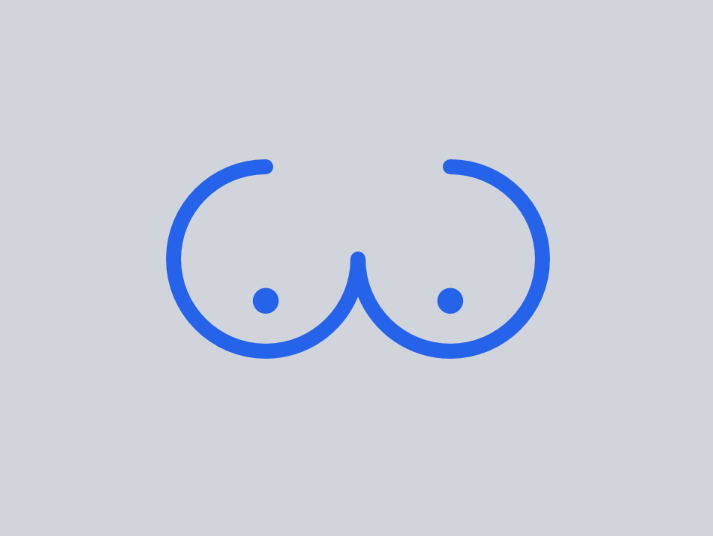
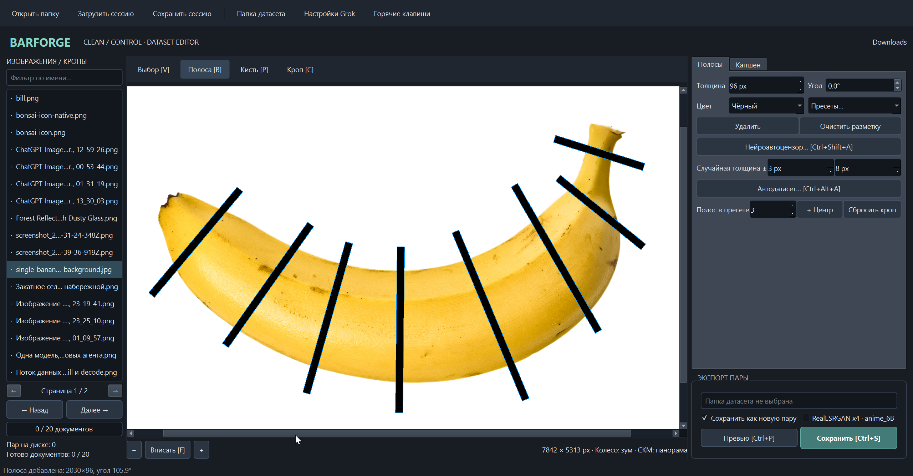
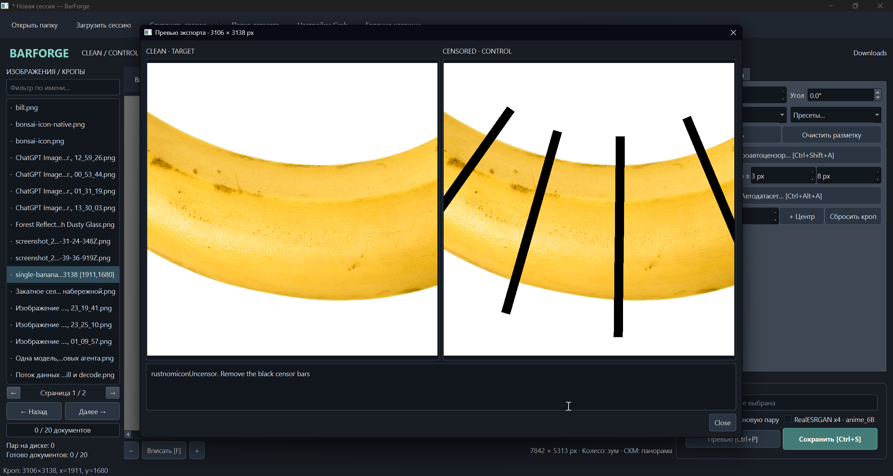
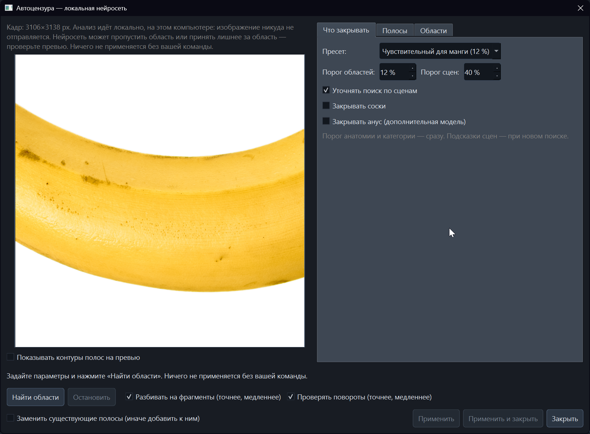
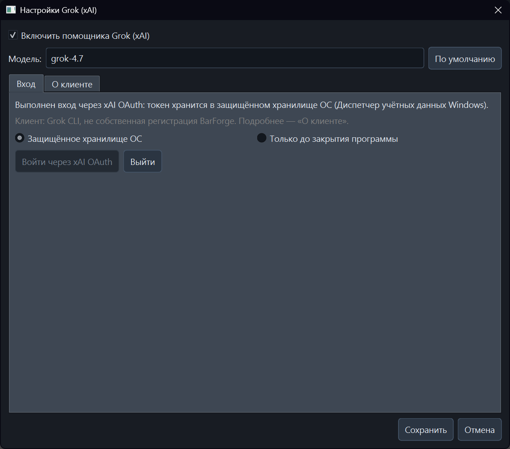

# BarForge

<p align="center">
  
</p>

Локальное Python-приложение на PySide6 для подготовки парного датасета редактирования изображений: **clean — target**, **censored — control**. Исходники не изменяются. Программа рисует новые полосы поверх чистого изображения, а не восстанавливает содержимое уже цензурированного исходника.

## Скриншоты

### Редактор разметки

Список исходников, кроп, полосы, кисть и капшены в главном окне.



### Предпросмотр пары

Сравнение **clean / target** и **censored / control** перед экспортом.



### Локальная нейроавтоцензура

Настройки поиска областей и предпросмотр исходного кадра. Анализ выполняется локально.



### Помощник Grok

Подключение xAI OAuth, выбор модели и параметры хранения токена.



## Установка и запуск

Python **3.10+**, Windows / Linux / macOS. GPU не нужен.

```powershell
# Windows PowerShell, из каталога проекта
python -m venv .venv
.\.venv\Scripts\python.exe -m pip install -e .
.\.venv\Scripts\python.exe -m barforge
```

```bash
# Linux / macOS
python3 -m venv .venv
.venv/bin/python -m pip install -e .
.venv/bin/python -m barforge
```

Альтернатива: `python -m pip install -r requirements.txt`, затем `python main.py`. После установки пакета доступна команда `barforge`. На Linux нужны системные библиотеки Qt/XCB и OpenGL; запускайте в графической сессии. Для автоматических проверок без экрана можно использовать `QT_QPA_PLATFORM=offscreen`.

## Сборка в GitHub Actions

Workflow [`.github/workflows/build.yml`](.github/workflows/build.yml) запускает тесты на Ubuntu и Windows для Python 3.12, затем собирает wheel и source distribution. Готовые файлы из `dist/` доступны в артефакте **barforge-python-packages** на странице успешного запуска Actions. Сборка выполняется для push в `main`, pull request и вручную через **Run workflow**.

## Рабочий процесс

1. **Открыть папку** с PNG/JPG/JPEG/WEBP. Список сортируется естественно (`2` перед `10`); подпапки не сканируются. Фильтр слева скрывает неподходящие имена, не удаляя документы из сессии.
2. Выбрать **Папка датасета…** — именно корень, не `clean` или `censored`.
3. При необходимости инструментом **Кроп** выделить панель. Кроп недеструктивный: оба экспортируемых изображения получают один и тот же прямоугольник. Маркеры меняют края кропа, перетаскивание внутри сдвигает его; `Shift` + перетаскивание создаёт новую рамку внутри старой. Сброс кропа возвращает полный исходник.
4. **Полоса**: клик по началу, затем отдельный второй клик по концу; направление произвольное. **Кисть** (`P`): протягивание ЛКМ создаёт свободный штрих с круглыми концами; до отпускания кнопки он только превью. Цвет и точная толщина общие для полосы и кисти. Зажатая боковая кнопка мыши + движение вправо/влево увеличивает/уменьшает толщину (8 экранных px на 1 px исходника). В **Выбор** полоса перемещается и меняется маркерами. Штрих отменяется одним Undo; **Очистить разметку** удаляет полосы и штрихи одним действием с Undo.
5. **Нейроавтоцензор…** (`Ctrl+Shift+A`) запускает локальный поиск чувствительных областей: проверьте предложения в отдельном диалоге и примените выбранные полосы. **+ Центр** — отдельный геометрический пресет без нейросети: он просто добавляет указанное число полос в центре изображения/кропа.
6. На вкладке **Капшен** введите текст или примените шаблон. Цвет: **Белый** → `white`, **Чёрный** → `black`. Каждая страница хранит собственный текст при переключениях; ещё не редактированная страница наследует последний использованный капшен. Уже заполненные страницы не перезаписываются. Загрузка сессии восстанавливает текст буквально и не подставляет в него текущий цвет.
7. При необходимости включите **RealESRGAN x4 · anime_6B** для текущего документа. **Превью clean / censored** показывает фактический результат экспорта, включая x4; тяжёлый расчёт идёт в фоне и его можно остановить.
8. **Сохранить пару** создаёт два PNG и UTF-8 `.txt`. Повторное сохранение того же документа требует подтверждения перезаписи. **Сохранить как новую пару** создаёт следующий номер и оставляет прежнюю пару — удобно для нескольких кропов одного исходника.
9. **Сохранить сессию** сохраняет полосы, штрихи, кропы, капшены, флаги x4, текущую позицию, путь датасета и привязки к экспортам. Перед закрытием или сменой проекта программа предлагает сохранить изменения. Автоматического сохранения нет.

### Шаблоны капшенов

В подготовленных шаблонах `{color}` заменяется выбранным цветом. Помимо **Общий** и **Без цвета**, доступны четыре типа:

| Тип | Шаблон |
|---|---|
| Пенис | `rustnomiconUncensor. Remove the {color} censor bars, penis, close-up` |
| Вагина | `rustnomiconUncensor. Remove the {color} censor bars, vagina, close-up` |
| Анус | `rustnomiconUncensor. Remove the {color} censor bars, anus, close-up` |
| Проникновение | `rustnomiconUncensor. Remove the {color} censor bars, penetration, penis penetrating vagina` |

Смена цвета сохраняет тип подготовленного капшена, а не сбрасывает его на общий. Вручную введённый `{color}` тоже подставляется в сохраняемый текст; сам редактор не переписывается. Другие фигурные скобки не интерпретируются. Пользовательский текст без `{color}` автоматически не меняется.

### Размер окон и навигация

Главное окно и диалоги подстраиваются под доступную область экрана с учётом рамки окна. Управление разнесено по вкладкам: в главном окне **Полосы / Капшен**, в автоцензоре **Что закрывать / Полосы / Области**, в настройках Grok — **Вход / О клиенте**.

Прокрутка остаётся у канвасов изображений. Для длинных списков исходников и найденных областей, капшенов и ответов Grok используются кнопки **← / →** с номером страницы: содержимое не обрезается и остаётся доступным без полос прокрутки.

### Структура датасета

```text
dataset/
├── clean/
│   ├── 001.png
│   ├── 001.txt
│   ├── 002.png
│   └── 002.txt
└── censored/
    ├── 001.png
    └── 002.png
```

Имена последовательные (`001`, `002`, …, `1000`, …), существующие номера не занимаются новым экспортом. PNG-пары имеют одинаковые размеры; без x4 экспорт сохраняет разрешение кропа, с x4 — ровно учетверяет каждую сторону. EXIF-ориентация применяется до рисования; прозрачные изображения компонуются на белом фоне и экспортируются в RGB. Полосы и штрихи обрезаются по границам изображения/кропа.

Счётчик показывает число полных пар на диске. Прогресс — число источников, чей последний экспорт соответствует текущей разметке: `✓` — актуален, `●` — после экспорта были изменения. Смена папки датасета сбрасывает привязки к старым экспортам, но не удаляет файлы. Экспортированные раньше кропы остаются на диске; в сессии хранится только текущая разметка каждого источника, а не история всех панелей.

### AI-Toolkit / FLUX.2 Klein

Укажите `clean` как целевые изображения, `censored` — как conditioning/reference. Капшены лежат рядом с target. Фрагмент секции датасета для совместимой версии AI-Toolkit:

```yaml
datasets:
  - folder_path: "C:/datasets/my_dataset/clean"
    control_path: "C:/datasets/my_dataset/censored"
    caption_ext: "txt"
    resolution: [512, 768, 1024]
```

Это **не полный конфиг обучения**: модель, архитектуру, бакеты и параметры LoRA выберите в своей версии AI-Toolkit. BarForge не запускает обучение и не требует установленного AI-Toolkit. Сопоставление выполняется по одинаковому имени файла. [Руководство BFL по edit-LoRA для Klein](https://huggingface.co/blog/black-forest-labs/flux-2-klein-lora#train-an-edit-lora).

## RealESRGAN x4 для кропов

В `barforge/assets/RealESRGAN_x4plus_anime_6B.onnx` включена официальная модель [xinntao/Real-ESRGAN](https://github.com/xinntao/Real-ESRGAN), оптимизированная для anime/манги: **6 RRDB-блоков**, масштаб **×4**. Используются `params_ema` из релиза `v0.2.2.4`. Модель конвертирована в ONNX; **PyTorch и скачивание при запуске не нужны**. Работает локально через ONNX Runtime на CPU, сеть и Grok не используются.

1. Выберите кроп и включите **RealESRGAN x4 · anime_6B** под превью. Флаг сохраняется отдельно для каждого документа и входит в подпись экспорта.
2. Откройте превью или сохраните пару. Clean и censored обрабатываются независимо одной и той же моделью, поэтому их размеры и координаты остаются выровненными. Пакетный диалог имеет такой же флаг для выбранного кропа.
3. Дождитесь результата. Прогресс показывает тайлы; **Остановить апскейл** отменяет работу между тайлами. Незавершённая пара не публикуется, уже завершённые пакетные пары и их checkpoint сохраняются.

Обработка идёт тайлами **128 px** с перекрытием **48 px**, чтобы ограничить память и уменьшить швы. Правый и нижний края дополняются отражением на 10 px, как в официальном inference. Максимум — **16 777 216 выходных пикселей** на сторону пары (например, 4096×4096); больший кроп нужно уменьшить. Долгий CPU-расчёт выполняется в фоне, но скорость зависит от процессора.

**Кеш апскейла.** Успешный результат каждой стороны (`clean` и `censored`) сохраняется отдельно. Ключ — SHA-256 точных RGB-пикселей участка, размера, SHA-256 ONNX-модели и параметров тайлинга. Поэтому повторное превью, сохранение, сохранение как новой пары и пакетный экспорт того же участка не запускают нейросеть; смена только капшена, имени пары или папки датасета тоже использует кеш. Любое изменение кропа, полос, штрихов, цвета или исходных пикселей даёт новый ключ: `clean` может остаться попаданием, а изменившаяся `censored`-сторона пересчитывается.

Кеш лежит между запусками: Windows — `%LOCALAPPDATA%\BarForge\cache\realesrgan`, Linux/macOS — `$XDG_CACHE_HOME/barforge/realesrgan` или `~/.cache/barforge/realesrgan`; путь можно задать переменной `BARFORGE_CACHE_DIR`. В памяти держатся 4 последних результата, на диске — PNG до **2 GiB** с удалением самых давно использованных. Запись атомарная; повреждённый или неверного размера файл удаляется и пересчитывается. Отменённый расчёт и ошибка модели в кеш не попадают. Ошибка записи кеша не отменяет готовую пару. Кеш можно удалить вручную — на датасет это не влияет.

**Это генеративное восстановление, не lossless-ресайз:** модель может перестраивать растровые точки и мелкие штрихи, создавать другую текстуру и артефакты. Для обучения проверяйте превью; исходник никогда не перезаписывается. Grok продолжает получать исходный кроп без x4, чтобы его координаты не смещались.

Происхождение, SHA-256 исходных весов и ONNX, архитектура и численная сверка записаны в `barforge/assets/MODELS.json`. Лицензия BSD-3-Clause сохранена в `barforge/assets/REALESRGAN-LICENSE.txt`.

## Сессии и большие папки

Сессия — версионированный JSON (`*.barforge.json`), без изображений и секретов. Текущий формат **v2** содержит штрихи и x4; **v1 читается**, при этом старые подписи экспорта документов без новых функций сохраняются. Пути хранятся относительно файла сессии, когда это возможно. Недоступные файлы не удаляются из сессии — восстановите их по сохранённым путям.

В памяти хранится текущее изображение и его отображение, остальные документы содержат только метаданные. Отмена/повтор относятся к геометрии текущего канваса и сбрасываются при переходе к другому исходнику; капшен использует стандартную отмену текстового редактора. Сессия не хранит историю Undo. Очень большие исходники всё равно требуют памяти пропорционально размеру изображения; не уменьшайте их до нанесения полос вне приложения, если нужна точность координат.

## Локальный нейроавтоцензор

Не требует Grok, API-ключа, GPU или отправки изображений в интернет. В `barforge/assets/` включены две ONNX-модели общим размером около 126 MB. Специализированная модель рисованных изображений даёт анатомические области; общие боксы гениталий второй модели **не используются для рисования**. Её сцены `make_love` служат только контекстом для уточнения, анус подключается отдельной опцией. GrabCut выделяет foreground внутри анатомического предсказания; полосы ограничиваются его контуром, вогнутостями и крупными фоновыми отверстиями. Модели работают через ONNX Runtime на CPU и переиспользуются между анализами.

1. Откройте изображение, при необходимости выделите кроп и нажмите **Нейроавтоцензор…**.
2. Выберите белый/чёрный цвет, **базовую толщину** в пикселях и шаг. По умолчанию включено **Поперёк органа (автоугол)**: у каждой выделенной области собственный угол. Поля **Случайная толщина ±** в главном окне и **Отклонение от / до** в диалогах задают диапазон автоматических линий: по умолчанию **3–8 px**, знак случайный. Допустимы целые **0–64 px**; **0 / 0** отключает вариацию, **4 / 4** даёт **±4 px**. При пересечении границ второе поле сдвигается. Ручная кисть и ручные полосы используют точную толщину без рандомизации; геометрический **+ Центр** также не рандомизируется. Отступ и масштаб меняют зону размещения; пороги анатомии и подсказок сцен задаются отдельно.
3. Для небольших областей включите анализ фрагментов; для разных ориентаций — проверку поворотов. Это медленнее, но на тестовой манга-странице повороты заметно улучшили поиск.
4. Запустите анализ. GUI остаётся отзывчивым; обработку можно остановить. Анализируется только текущий кроп, координаты возвращаются в систему исходника.
5. Снимите отметки с ложных/лишних предложений. Цвет, базовая толщина, диапазон отклонений, шаг и угол меняются по уже найденным областям без повторного запуска нейросетей. Затем добавьте линии к текущим или замените существующие. Вставка отменяется одним Undo.

Режим создаёт **тонкие линии с открытыми промежутками**, а не заливку прямоугольника детекции. По умолчанию: толщина **6 px**, отклонения **3–8 px** со случайным знаком, шаг **48 px**, **автоугол поперёк каждой области**, отступ **0%**. Базовый ручной угол **65°** используется только при выключенном автоугле. Минимальная фактическая толщина — **1 px**; малый шаг или малая область ограничивают вариацию, сохраняя промежутки. Вся прямоугольная полоса должна помещаться внутри выделенной формы, а не только её средняя линия.

Повторные предсказания одного foreground объединяются до выбора угла, чтобы не создавать наложенные сетки. Рисунок толщин стабилен при смене цвета и отметок областей; изменение диапазона масштабирует его, а не перемешивает. Длина и количество линий зависят от формы области. После применения можно перемещать линии, менять размеры маркерами и угол через **Угол выбранной**. Фактические толщина и угол каждой полосы сохраняются в сессии и экспорте.

**Ограничение:** детектор не гарантирует полноты и семантической точности, особенно в манге. GrabCut уточняет форму, но сам не распознаёт анатомию. Низкий порог повышает чувствительность и число ложных срабатываний. Если форма не выделилась, область пропускается — широким боксом сцены она не заменяется. Сцены никогда не становятся цензурными масками, даже при включённой опции. Перед публикацией проверяйте ложные области, пропуски и правильность выделенного foreground вручную.

Модели и происхождение: [deepghs/anime_censor_detection](https://huggingface.co/deepghs/anime_censor_detection), [EraX-Anti-NSFW-V1.1](https://huggingface.co/erax-ai/EraX-Anti-NSFW-V1.1). Ревизии, контрольные суммы, параметры ONNX-экспорта и заявленные лицензии находятся в `barforge/assets/MODELS.json`. Карточка EraX указывает Apache-2.0, а экспортёр Ultralytics добавил в ONNX метаданные AGPL-3.0; перед распространением весов проверьте применимые условия обеих сторон. Для работы приложения PyTorch и Ultralytics не нужны.

### Автодатасет: папка → кропы → просмотр → пары

1. Откройте папку исходников и нажмите **Автодатасет…** (`Ctrl+Alt+A`). Можно обработать всю папку либо только текущее изображение. Работа полностью локальная.
2. На вкладке **Автокроп** настройте контекст, минимальную сторону и форму. По умолчанию кроп следует пропорциям анатомической области с контекстом **1.35×** и минимальной стороной **128 px**, а не рамкам панелей или боксам действий. Квадрат и фиксированные пропорции — отдельные варианты; исходник не растягивается и не увеличивается. Число кропов ограничено; целая страница добавляется только явно.
3. На вкладках **Полосы**, **Поиск** и **Капшен** настройте стиль, категории, пороги и шаблон. Нажмите **Найти и подготовить**. Каждый завершённый исходник остаётся доступен для просмотра даже после остановки обработки папки.
4. На вкладке **Результаты** проверьте кропы и полосы, снимите отметки с ложных предложений. Канвас поддерживает полосы двумя кликами, кисть, кроп и Undo/Redo; капшен редактируется отдельно для каждого кандидата. Флаг x4 задаётся для выбранного кропа. **Превью пары** показывает clean/control и капшен, включая фактический x4-результат.
5. **Перестроить из кеша** заново рассчитывает кропы и полосы без нейросетевого прохода. Оно заменяет ручные правки после подтверждения. Изменения файлов, фрагментов, поворотов или подсказок сцен требуют нового поиска; пороги анатомии, категории и стиль применяются к уже найденным областям.
6. Выберите папку датасета и нажмите **Экспортировать выбранные**. Сохраняются выровненные `clean/*.png`, `clean/*.txt`, `censored/*.png` и отдельная `batch-*.barforge.json`. Сессия обновляется после каждой опубликованной пары. При отмене или ошибке готовые пары не теряются; восстановите их обычной загрузкой сессии.
7. Неизменные экспортированные кандидаты повторно не публикуются, в том числе после перестроения из кеша. Изменённый вариант получает новый номер; прежняя пара остаётся. **В редактор** добавляет выбранные документы в основную сессию без неявного экспорта.

Это предложения для проверки, не гарантированно готовая разметка. Области соседних органов, попавшие в кроп, получают те же полосы, что и на полной странице. Автокроп не является распознаванием панелей и не создаёт пары для сцены без найденной анатомии.

### Подготовленный пример Desktop/test.webp

Исходник конвертирован в `Desktop/test.png` размером **1280 × 1806**. В `Desktop/BarForge-auto/` сохранены:

- `test_black_small.png`, `test_black_medium.png`, `test_black_large.png`;
- `test_white_small.png`, `test_white_medium.png`, `test_white_large.png`;
- одноимённые `*.barforge.json` — редактируемая разметка каждого варианта, ссылающаяся на `../test.png`;
- `test_black_auto.png`, `test_white_auto.png` и `detections.json` — исходный результат автоматического прохода;
- `reviewed.json` — явная история отбора кандидатов для готовых вариантов.

При пороге 0.12 модели дали **14 кандидатов**. После ручной проверки оставлены **5 областей**; новые координаты в детектор не зашивались. Варианты `small` / `medium` / `large` используют линии **4 / 6 / 8 px**, шаг **44 / 52 / 60 px** и угол **65°**. Это частичная художественная цензура: между линиями исходник остаётся виден. Отдельных положительных детекций `make_love` на этом примере не было: варианты созданы по анатомическим областям. Исходные WEBP и PNG не заменялись цензурированным результатом.

Эти сохранённые примеры созданы до добавления вариации толщины и не переписываются автоматически. Вариация применяется при новой генерации полос в нейроавтоцензоре; ручное рисование и уже сохранённая разметка не изменяются.


## Grok — опционально, через агентный OAuth

Без выполненного OAuth-входа **Спросить Grok** недоступна; загрузка, разметка, превью и экспорт работают локально без сетевых запросов. API-ключ не нужен и не используется: ввод ключа и чтение `XAI_API_KEY` удалены.

1. Откройте **Настройки Grok…**, включите помощника и выберите доступную вашему аккаунту модель с поддержкой изображений. Название модели редактируемое: доступность моделей меняется.
2. Выберите **защищённое хранилище ОС** для сохранения входа между запусками либо **только на время сессии**. Если безопасное хранилище недоступно, вход возможен только до закрытия программы; plaintext-файлы не используются.
3. Нажмите **Войти через xAI OAuth**. Откроется официальная страница xAI в браузере. Сверьте показанный код устройства, войдите в аккаунт и подтвердите доступ. При необходимости скопируйте код или повторно откройте страницу кнопками диалога.
4. Дождитесь подтверждения входа в приложении и нажмите **Сохранить**. Ожидание выполняется в фоне; незавершённый вход можно отменить. Закрытие настроек отменяет ожидающий вход, поздний ответ не сохраняет сессию.
5. Нажмите **Спросить Grok…**. Выберите генерацию/улучшение капшена, предложения полос либо краткое нейтральное описание сцены и анатомии, затем **Отправить в Grok**. Дополнительной галочки согласия нет. Сам OAuth-вход и открытие диалога изображения не отправляют; ответ применяется отдельной кнопкой после проверки.

**Идентичность клиента:** используется публичный OAuth-клиент **Grok CLI**, применяемый агентными харнессами, а не собственная регистрация BarForge. Авторизация — настоящий device-code flow через `auth.x.ai`; браузерная страница — `accounts.x.ai`. Приложение не читает cookie и не запрашивает пароль xAI. Пользователь должен явно одобрить вход на странице провайдера.

**Доступ определяет xAI:** успешная авторизация не гарантирует доступ выбранной подписки/аккаунта к inference API или каждой модели. При `403` приложение показывает отказ; оно не обходит ограничения и не подставляет API-ключ. Запросы расходуют доступную вашему аккаунту квоту; OAuth не означает бесплатный или неограниченный доступ.

Секреты хранятся только в разрешённых защищённых backend keyring ОС или в памяти процесса. В JSON-настройках остаются лишь включение интеграции и модель; в сессии датасета токенов нет. При наличии refresh-токена именно он сохраняется в keyring, а короткоживущий access-токен возобновляется при необходимости. Обновление выполняется последовательно, с сохранением ротации refresh-токена. Режим «только на время сессии» удаляет прежнюю постоянную OAuth-запись, чтобы она не восстановилась после перезапуска.

**Выйти** забывает локальную OAuth-сессию и запрашивает отзыв доступа в xAI. Если провайдер недоступен или keyring не разрешил удаление, приложение сообщает об этом; при неудачном удалённом отзыве доступ можно отозвать в аккаунте xAI. Выключение помощника само по себе не является выходом.

Отправляется чистое текущее изображение **или текущий кроп**, а не весь набор. Используется HTTPS `https://api.x.ai/v1/responses`, OAuth Bearer access token, изображение как data URL и `store: false`. Подготовка изображения, запросы, вход, обновление и отзыв токенов выполняются в фоне. Капшен и предложения полос сначала показываются для проверки и применяются отдельными кнопками; описание сцены само не меняет капшен. Координаты предложений переводятся в пиксели текущего кропа; устаревший ответ не применяется к изменённому документу.

Перед отправкой убедитесь, что имеете право передавать изображение внешнему сервису и оно соответствует его правилам. `store: false` не заменяет условия обработки данных xAI.

Контракт и источники: [официальный OIDC discovery xAI](https://auth.x.ai/.well-known/openid-configuration), [агентный OAuth в Hermes](https://hermes-agent.nousresearch.com/docs/guides/xai-grok-oauth), [image understanding](https://docs.x.ai/developers/model-capabilities/images/understanding), [Responses API](https://docs.x.ai/developers/rest-api-reference/inference/responses).

## Горячие клавиши

| Клавиши | Действие |
|---|---|
| `Ctrl+O` | Открыть папку |
| `Ctrl+L` | Загрузить сессию |
| `Ctrl+Shift+S` | Сохранить сессию |
| `Ctrl+S` | Сохранить пару |
| `Ctrl+P` | Превью пары |
| `Ctrl+Shift+A` | Локальный нейроавтоцензор |
| `Ctrl+Alt+A` | Автодатасет: поиск, кропы, просмотр и пакетный экспорт |
| `Alt+←`, `Alt+→` | Предыдущий / следующий видимый файл |
| `V`, `B`, `P`, `C` | Выбор, полоса, кисть, кроп (фокус на канвасе) |
| `F` | Вписать изображение (фокус на канвасе) |
| `Delete` | Удалить выделенную полосу (фокус на канвасе) |
| `Ctrl+Z`, `Ctrl+Shift+Z` | Отмена / повтор геометрии (фокус на канвасе) |
| Колесо мыши | Зум вокруг курсора |
| Средняя кнопка + перетаскивание | Панорамирование |
| Боковая кнопка + движение влево/вправо | Уменьшение / увеличение общей толщины полосы и кисти |
| `Shift` + колесо / `Alt` + колесо | Горизонтальная / вертикальная прокрутка |
| `Esc` | Отменить незавершённую полосу / текущий жест или снять выделение |

Буквенные команды не перехватывают ввод в капшене.

## Структура кода

- `barforge/app.py` — запуск, оформление Qt.
- `barforge/main_window.py` — `MainWindow`, workflow и превью.
- `barforge/ui.py` — ограничение размеров окон экраном и постраничная навигация по длинным спискам и текстам.
- `barforge/canvas.py` — `ImageCanvas`, графические элементы и интерактивная геометрия.
- `barforge/models.py` — `Document`, `Bar`, `BrushStroke`, `Rect`, `Session`, проверка актуальности экспорта.
- `barforge/imaging.py` — Pillow/OpenCV, ориентация, кроп, растеризация полос и кисти, автопресет.
- `barforge/storage.py` — поиск файлов, версионирование сессий и безопасная запись пар.
- `barforge/autocensor.py` — двухмодельный ONNX-поиск, фрагменты/повороты и ограниченные foreground полосы.
- `barforge/anatomy.py` — отделение анатомических предсказаний от сцен, GrabCut, контуры, отверстия и объединение повторных foreground.
- `barforge/automation.py` — кеш анализа страницы, контекстные кропы, цензура соседних областей и восстанавливаемый пакетный экспорт.
- `barforge/automation_ui.py` — фоновая очередь папки, просмотр/правка кандидатов и публикация выбранных пар.
- `barforge/autocensor_ui.py` — асинхронный анализ, просмотр кандидатов и применение выбранных полос.
- `barforge/upscale.py` — официальный RealESRGAN_x4plus_anime_6B через ONNX Runtime, тайлы и отмена.
- `barforge/upscale_ui.py` — фоновые x4-превью и одиночный экспорт без блокировки Qt.
- `barforge/grok.py` — OAuth-транспорт xAI, разбор ответа и несекретные настройки.
- `barforge/xai_oauth.py` — device-code вход, защищённое хранение, обновление и отзыв OAuth-сессии.
- `barforge/grok_ui.py` — настройки OAuth, фоновые задания и просмотр ответов.

Обработка изображений не зависит от GUI; сцена не используется как источник экспортируемого PNG. Секреты не входят в модель сессии.

## Проверки

Поведенческие проверки тонких линий с промежутками, поворотов, кропа, сессий, отката неудачной перезаписи, безопасного разбора ответа Grok, OAuth и Qt-диалогов запускаются стандартным `unittest`:

```bash
python -m unittest discover -s tests -v
```

Проверено: **74 теста проходят**. Регрессии покрывают анатомические полосы, диапазоны вариации, капшены между страницами и при загрузке, кисть с Undo/Redo, боковые кнопки мыши, сессии v1/v2, одиночный и пакетный x4-экспорт, кеш апскейла, отмену без частичной пары, Grok и OAuth. История прежних проверок приведена ниже.

Официальный RealESRGAN сконвертирован из `params_ema` и сверен с PyTorch на входе **53×37**: выход **212×148**, максимальная абсолютная ошибка **7.75×10⁻⁷**. На реальном кропе **539×454** получены выровненные **2156×1816** clean/control; PNG совпали с рендером, капшен и сессия с кистью/x4 восстановились, SHA-256 исходника не изменился. Перекрытие **48 px** выбрано по замерам: на контрольном кропе средняя разница с однопроходным inference — **0.000263**, максимум — **2 уровня канала**; с исходными 10 px отличия были заметно больше. Полный контрольный сценарий занял **42.56 с** на CPU, включая экспорт и сравнение.

Кеш проверен на настоящей RealESRGAN: первое превью **100×80** — **2 ONNX-тайла, 0.703 с**; второе превью, сохранение того же участка и сохранение с изменённым капшеном — **0 тайлов** (мгновенно из памяти); новый процесс читает оба PNG с диска за **0.047 с**, без inference. В кеше два файла, всего около **123 KB**.

Настоящий Qt-прогон подтвердил наследование и возврат капшенов, кисть до отпускания/после, один шаг Undo/Redo, изменение толщины зажатой `XButton1`, фактическое x4-превью и экспорт **40×30 → 160×120**, значения диапазона **±2…±5 px** и неизменность исходника. Главное окно помещается в **1024×720** и **1280×720** без прокрутки вне канвасов; heartbeat Qt продолжался во время расчёта.

Исправленный конвейер проверен настоящими ONNX-моделями на всех **20 исходниках** указанной манга-папки: **44 предложения**, после визуального отбора сохранено **29 пар** в `Desktop/BarForge-auto-519618-corrected/`. Для каждой пары проверены совпадение clean с исходным кропом, точное соответствие PNG текущей разметке, капшен и загрузка сессии. Изменённые пиксели остаются внутри предсказанного foreground с допуском 1 px на растеризацию; это геометрическая проверка, **не гарантия семантической точности**. SHA-256 всех 20 исходников остались прежними. Старый автоматический каталог и эталонный датасет не перезаписывались.

Сопоставление с 16 пользовательскими эталонными кропами выявило пропуски: при пороге 12% автоматические полосы появились в **9 из 16** кропов; **002, 007, 008, 009, 012, 013, 014** пропущены. Среди 44 предложений также были ложные объекты, исключённые при просмотре. Результаты нельзя считать полностью автоматической готовой разметкой. В новом каталоге сохранены `analysis.json`, `review.json`, `automation-report.json`, `reference-check.json`, `reference-comparison.png` и восстанавливаемая `batch-*.barforge.json`; координаты эталонов не зашиваются в приложение.

В настоящем GUI проверены отдельные поперечные углы областей, переключение на ручные 37° и обратно без нового инференса, применение полос, пакетная правка кропа и Undo/Redo, экспорт, восстановление сессии, отсутствие повторных пар после перестроения, остановка и закрытие во время анализа. Одиночный автоцензор и пакетный диалог проверены при **1024 × 720** и **1280 × 720 px**, без полос прокрутки вне канвасов; Qt-таймер продолжал работать во время анализа.

### История предыдущих проверок

Последний GUI-прогон проверил главное окно, автоцензор, состояния OAuth и все три задачи Grok в рамках **1024 × 720** и **1280 × 720 px**. Проверены доступность управляющих элементов без полос прокрутки вне канвасов, страницы **120 исходников**, длинных капшенов и ответов, экспорт **10 `.txt`**, четыре анатомических шаблона в обоих цветах и сохранение типа при смене цвета и применении автоцензуры. Диапазоны **2–5**, **0–0** и **4–4** пересчитывались без нового анализа. Области и ответы xAI в этом прогоне были явно синтетическими; OAuth и запросы проходили через настоящий локальный HTTP-сервер, без реального входа в аккаунт и inference xAI.

Рисование двумя кликами проверено в настоящем GUI: отдельный первый клик и превью без изменения документа, второй клик с сохранением направления, вертикальная чёрная полоса снизу вверх, отмена `Esc`, один шаг Undo/Redo, перемещение наклонной полосы и прежнее протягивание кропа. Экспортированная пара **510 × 450 px** сохранила наклон **36.42°**, сессия восстановила геометрию, исходный PNG остался побайтно неизменным. Регрессии также проверяют совпадающие точки и сброс первой точки при смене инструмента/изображения.

Вариация дополнительно проверена в GUI на явно синтетических областях, без повторной проверки нейросетевого поиска: изменение цвета и отметок не перемешало толщины, изменение базовой толщины сохранило индивидуальные отклонения, повторный анализ не запускался. Превью, применённые **22 полосы**, экспорт **720 × 640 px** и восстановленная сессия сохранили фактические толщины; исходник не изменён.

На `test.png` выполнен настоящий двухмодельный проход с фрагментами и поворотами. Готовый белый `medium` содержит **53 линии по 6 px**, шаг **52 px**, угол **65°**; изменено около **3.6% пикселей** исходника вместо сплошной заливки. Все шесть готовых вариантов пересозданы; PNG-исходник остался побайтно неизменным.

OAuth дополнительно проверен в настоящем GUI через локальный HTTP-сервер: отмена и повторный вход, отображение device code, обновление и ротация токенов, три задачи Grok, кроп **180 × 140 px**, проверка ответа перед применением, выход с отзывом, отказ `403` без подстановки ключа и отключение кнопки после `401`. Во время сценария Qt-таймер продолжал работать.

Отправка Grok без галочки согласия проверена в настоящем диалоге через локальный HTTP-сервер: открытие окна ничего не отправляет, одно нажатие «Отправить в Grok» делает один запрос, результат не применяется до отдельного нажатия кнопки применения.

Код приложения также получил **настоящий device code от xAI** через live discovery и device endpoint: HTTP 200, страница подтверждения `accounts.x.ai`, интервал опроса 5 секунд; неподтверждённый вход затем отменён. В Диспетчере учётных данных Windows отдельно проверены сохранение и восстановление фиктивного refresh-токена в уникальной тестовой записи; запись удалена, пользовательские учётные данные не затрагивались. **Подтверждение входа в реальный аккаунт и реальный inference xAI не выполнялись** — для этого требуется одобрение пользователя на странице xAI.

Ранее также проверены зум, панорамирование и превью пар. Временные проверочные сценарии удаляются после прогона; постоянные регрессионные проверки остаются в `tests/`.
